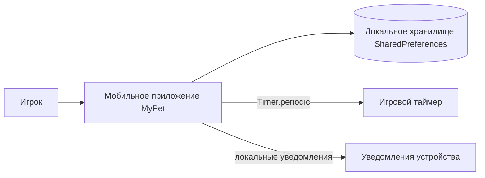
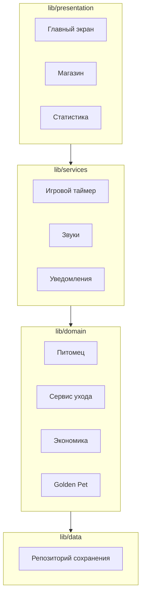
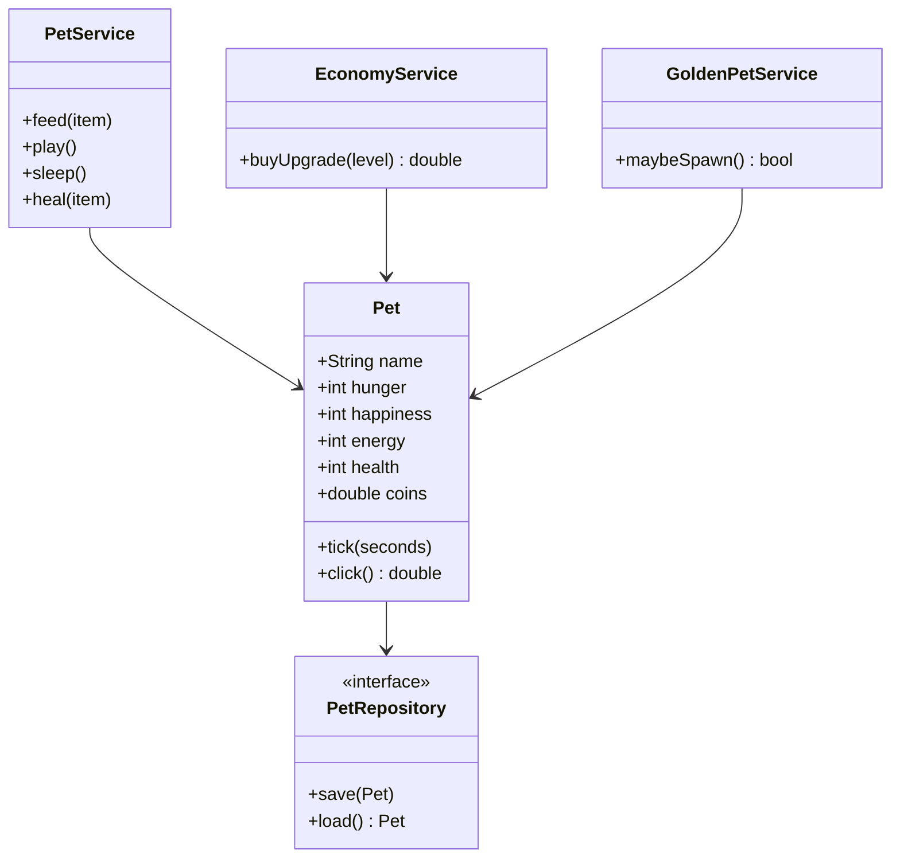
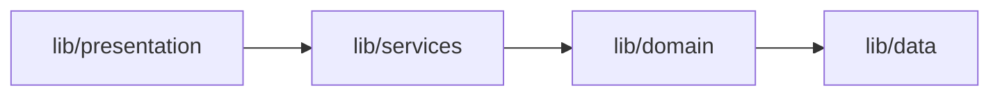
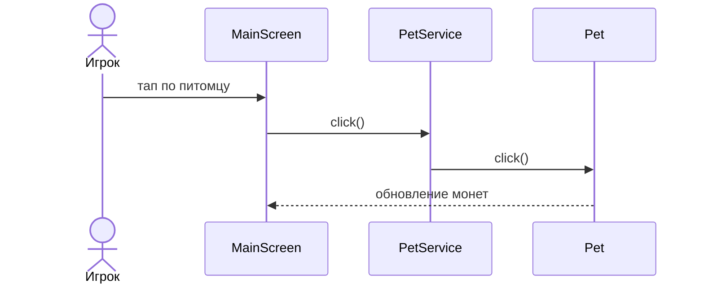
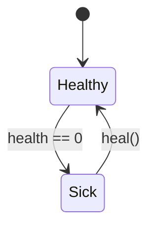
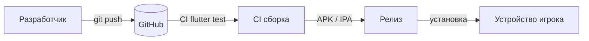

# Описание дизайна программного обеспечения
Для MyPet

Версия 1.3

Подготовил Зинькович Д. А.

БГУИР, кафедра ЭВМ

2026-11-23

## Оглавление
1. Введение
2. Обзор дизайна
3. Проектные представления
4. Решения
5. Приложения

## История изменений

| Name | Date | Reason For Changes | Version |
|------|------|--------------------|---------|
| Зинькович Д. А. | 2026-11-16 | Первая версия SDD | 1.1     |
| Зинькович Д. А. | 2026-11-20 | Правки по итогам первого раунда обсуждения с Заказчиком: уточнены оценки, скорректированы приоритеты, обновлён план | 1.2     |
| Зинькович Д. А. | 2026-11-23 | Правки по итогам второго раунда: добавлены Golden Pet, Sound; подключён junior; обновлены план и требования | 1.3     |

---

## 1. Введение

### 1.1 Назначение документа
Документ описывает проектные решения мобильной игры-кликера MyPet: состав модулей, взаимодействие, данные, алгоритмы и принятые архитектурные решения. Предназначен разработчикам (реализация и сопровождение), преподавателю (оценка процесса) и Заказчику (понимание состава продукта). Вытекает из бизнес-требований (`srs/srs.md`) и системных требований (`srs/system-requirements.md`).

### 1.2 Область применения
Проектируется MyPet версии 0.x — однопользовательское офлайн-приложение для Android/iOS на Flutter (Dart). Игрок кликает по питомцу, получает монеты, следит за шкалами (голод, счастье, энергия, здоровье), покупает предметы и ухаживает за питомцем; прогресс сохраняется локально.

**Входит:** игровая логика, интерфейс, локальное сохранение, офлайн-деградация шкал, уведомления, сборка.
**Не входит:** сетевые функции, учётные записи, рейтинги, платежи, веб-версия.

### 1.3 Определения, акронимы и сокращения

| Term | Definition |
|------|------------|
| ADR | Architecture Decision Record — запись архитектурного решения |
| SDD | Software Design Document — документ описания проектирования |
| SRS | Software Requirements Specification — спецификация требований |
| FR/NFR | Functional / Non-functional Requirement |
| Domain-слой | Слой игровой логики без зависимостей от Flutter |
| Tick | Периодический шаг игрового времени |
| Шкалы | Голод, счастье, энергия, здоровье питомца |

### 1.4 Ссылки

| Документ | Тип | Расположение |
|---|---|---|
| Бизнес-требования (SRS) | справочный | `srs/srs.md` |
| Системные требования | нормативный | `srs/system-requirements.md` |
| Протоколы архитектурных решений | нормативный | `adr/adr.md` |
| План итераций | справочный | `plan/iteration-plan.md` |

### 1.5 Обзор документа
Раздел 2 определяет стейкхолдеров и выбранные точки зрения. Раздел 3 содержит проектные представления (`001-context` … `013-resources`) со ссылками на требования и решения. Раздел 4 перечисляет ADR. Раздел 5 — приложения. Документ ведётся в Git; изменения фиксируются в истории изменений.

---

## 2. Обзор дизайна

### 2.1 Задачи стейкхолдеров

| Стейкхолдер | Основные задачи | Точки зрения |
|---|---|---|
| Игрок | Отзывчивый интерфейс, сохранность прогресса, понятная прогрессия | Context, Interaction, State dynamics, Information |
| Заказчик | Соблюдение сроков и бюджета | Composition, Resources, Patterns |
| Разработчик | Простота изменения, тестируемость | Logical, Dependency, Interface, Algorithm |
| Тестировщик | Проверка логики без UI | Logical, Interface, Algorithm |
| Преподаватель | Прослеживаемость требований → дизайн → решения | Все представления |

### 2.2 Выбранные точки зрения

#### 2.2.1 Контекст
Выбрана: границы системы и акторы. Язык: диаграмма вариантов использования.
#### 2.2.2 Композиция
Выбрана: разбиение на модули Flutter. Язык: диаграмма компонентов.
#### 2.2.3 Логическое представление
Выбрана: классы domain-слоя. Язык: диаграмма классов UML.
#### 2.2.4 Физическое представление
Не используется: приложение работает на устройстве игрока, специальной инфраструктуры нет.
#### 2.2.5 Структура
Отдельно не выбрана: организация показана в 002-composition и 003-logical.
#### 2.2.6 Зависимости
Выбрана: контроль связанности слоёв. Язык: диаграмма пакетов.
#### 2.2.7 Информация
Выбрана: структура локального хранилища. Язык: таблица схемы.
#### 2.2.8 Интерфейс
Выбрана: контракты сервисов. Язык: сигнатуры методов.
#### 2.2.9 Взаимодействие
Выбрана: сценарии «клик», «кормление», «сохранение». Язык: диаграммы последовательности.
#### 2.2.10 Алгоритм
Выбрана: формулы клика, деградации шкал, экономики. Язык: псевдокод и формулы.
#### 2.2.11 Динамика состояний
Выбрана: состояния питомца (здоров → болен) и жизненный цикл приложения. Язык: конечные автоматы.
#### 2.2.12 Параллелизм
Выбрана: политика таймеров (UI-поток + Timer.periodic). Язык: таблица.
#### 2.2.13 Паттерны
Выбрана: Repository, Observer, слоистая архитектура. Язык: таблица.
#### 2.2.14 Развёртывание
Выбрана: сборка APK/IPA и запуск на устройстве. Язык: диаграмма развёртывания.
#### 2.2.15 Ресурсы
Выбрана: память, файловая система, таймеры. Язык: таблица.

---

## 3. Проектные представления

### 001-context

- **ID:** 001-context
- **Title:** Контекст системы
- **Viewpoint:** Context
- **Реализует требования:** SYS-FUNC-001…014, SYS-NFR-004 (офлайн)
- **Решения:** ADR-0001, ADR-0002

Единственный внешний «сервис» — локальное хранилище. Сети нет.

### 002-composition

- **ID:** 002-composition
- **Title:** Состав системы
- **Viewpoint:** Composition
- **Реализует требования:** SYS-NFR-008 (тестируемость domain)
- **Решения:** ADR-0003

### 003-logical

- **ID:** 003-logical
- **Title:** Логическая структура классов
- **Viewpoint:** Logical
- **Реализует требования:** SYS-FUNC-001…009

### 004-dependency

- **ID:** 004-dependency
- **Title:** Зависимости слоёв
- **Viewpoint:** Dependency
- **Реализует требования:** SYS-NFR-008

Правило: `domain` не импортирует `package:flutter`; проверяется архитектурным тестом.

### 005-information

- **ID:** 005-information
- **Title:** Данные сохранения
- **Viewpoint:** Information
- **Реализует требования:** SYS-FUNC-008, SYS-FUNC-009, SYS-NFR-003
- **Решения:** ADR-0002

Локальный JSON в `SharedPreferences` (ключ `pet_state`), резервная копия — `pet_state.bak`.

| Поле | Тип | Смысл |
|---|---|---|
| `name` | string | имя питомца |
| `hunger` | int 0..100 | сытость |
| `happiness` | int 0..100 | счастье |
| `energy` | int 0..100 | энергия |
| `health` | int 0..100 | здоровье |
| `coins` | double ≥ 0 | монеты |
| `savedAt` | long (epoch sec) | момент сохранения |
| `upgrades` | map | уровни улучшений |
| `achievements` | list | полученные достижения |

### 006-interface

- **ID:** 006-interface
- **Title:** Контракты сервисов
- **Viewpoint:** Interface

| Класс | Метод | Контракт |
|---|---|---|
| `Pet` | `click()` | начисляет монеты, увеличивает счётчик кликов |
| `Pet` | `tick(seconds)` | деградация шкал за время |
| `PetService` | `feed(item)` | повышает сытость, списывает монеты |
| `PetService` | `play()` | повышает счастье, снижает энергию |
| `PetService` | `sleep()` | восстанавливает энергию |
| `PetService` | `heal(item)` | лечит при нуле здоровья |
| `PetRepository` | `save/load` | сохранение/загрузка состояния |
| `GoldenPetService` | `maybeSpawn()` | случайный бонус |

### 007-interaction

- **ID:** 007-interaction
- **Title:** Сценарии взаимодействия
- **Viewpoint:** Interaction
- **Реализует требования:** SYS-FUNC-002, SYS-FUNC-004

Сценарий «кормление»: `feed(item)` → проверка монет → изменение `hunger` → обновление UI. Путь отказа: монет не хватает — состояние не меняется.

### 008-algorithm

- **ID:** 008-algorithm
- **Title:** Игровые формулы
- **Viewpoint:** Algorithm
- **Реализует требования:** SYS-FUNC-002, SYS-FUNC-003, SYS-FUNC-009
- **Решения:** ADR-0005

| Величина | Формула |
|---|---|
| Монеты за клик | `1 + Σ clickBonus(u) · level(u)` |
| Цена улучшения | `ceil(baseCost · 1.15^L)` |
| Деградация шкалы | `value − rate · seconds`, не ниже 0 |
| Офлайн-деградация | `rate · clamp(now − savedAt, 0, 8 ч)` |

### 009-state-dynamics

- **ID:** 009-state-dynamics
- **Title:** Динамика состояний
- **Viewpoint:** State dynamics
- **Реализует требования:** SYS-FUNC-007

### 010-concurrency

- **ID:** 010-concurrency
- **Title:** Политика потоков
- **Viewpoint:** Concurrency
- **Реализует требования:** SYS-NFR-002, SYS-NFR-003
- **Решения:** ADR-0004

| Активность | Поток | Механизм |
|---|---|---|
| UI, клики | UI isolate | жесты Flutter |
| Игровое время | UI isolate | `Timer.periodic` |
| Автосохранение | UI isolate | `Timer.periodic` 30 с |

Вся работа с моделью — в одном isolate; гонок нет.

### 011-patterns

- **ID:** 011-patterns
- **Title:** Применённые паттерны
- **Viewpoint:** Patterns

| Паттерн | Где | Зачем |
|---|---|---|
| Layered Architecture | presentation/services/domain/data | разделение логики и UI |
| Repository | `PetRepository` | абстракция хранилища |
| Observer | Flutter `ChangeNotifier` | обновление UI |
| Enum with behavior | улучшения, предметы | расширяемость без правки ядра |

### 012-deployment

- **ID:** 012-deployment
- **Title:** Развёртывание
- **Viewpoint:** Deployment
- **Реализует требования:** SYS-NFR-001
- **Решения:** ADR-0001

### 013-resources

- **ID:** 013-resources
- **Title:** Использование ресурсов
- **Viewpoint:** Resources
- **Реализует требования:** SYS-NFR-002

| Ресурс | Оценка / ограничение |
|---|---|
| Память | ≤ 200 МБ |
| Диск | сохранение < 4 КБ |
| Таймеры | 2 (`tick`, автосохранение) |
| Запуск | ≤ 2 с |

---

## 4. Решения

| ID | Название | Статус |
|---|---|---|
| ADR-0001 | Flutter + Dart для кроссплатформенного мобильного клиента | accepted |
| ADR-0002 | Локальное сохранение JSON в SharedPreferences | accepted |
| ADR-0003 | Изоляция игровой логики в domain-слое | accepted |
| ADR-0004 | Таймеры деградации шкал через Timer.periodic | accepted |
| ADR-0005 | Экономика: цена улучшения ×1.15 за уровень | accepted |

---

## 5. Приложения

- Системные требования: `srs/system-requirements.md`
- Мокапы: `srs/img/mockup-*.png`
- Трассировка требований: таблица в `srs/system-requirements.md`